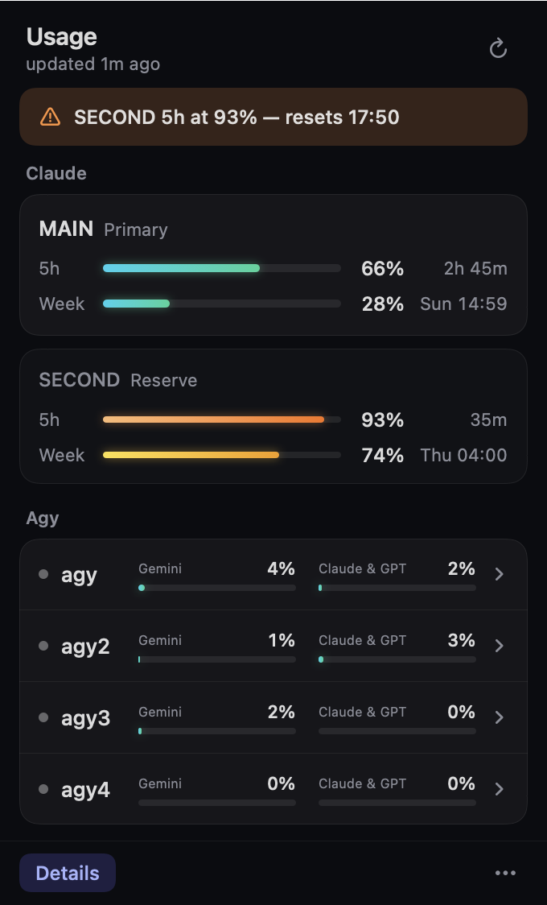
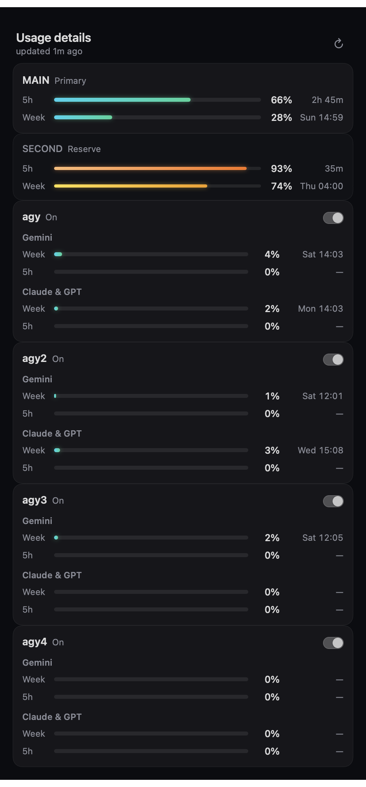

# Usage

A small macOS menu bar app that shows the **5-hour and weekly limits of your AI coding accounts** in one place:
**Claude Code** (any number of accounts) and **agy** (Google Antigravity CLI, any number of accounts) — so you never have to run `/usage` in each tool.

- **Menu bar:** two concentric gradient rings + one number. Outer ring = 5-hour limit, inner ring = weekly limit, number = 5-hour %, for the account you pick (`menuBarAccount`).
  Each ring is coloured by its own level (neutral < 70 · amber 70–85 · orange 85–95 · red ≥ 95). A small orange dot means an agy account needs sign-in or the data is stale.
- **Popover:** one card per Claude account, one row per agy account with mini usage bars (click a row or **Details** for the full breakdown), an alert strip when a Claude limit is ≥ 85%, and a `…` menu.
- Light and dark mode, everything shown as **% used**. Design spec: [`design/`](design).

 


## Requirements

- macOS 14 (Sonoma) or newer
- Xcode Command Line Tools (`xcode-select --install`) — provides Swift 5.9+
- At least one of:
  - [Claude Code](https://claude.com/claude-code), signed in (the app reuses the login Claude Code keeps in your keychain)
  - `agy`, the Google Antigravity CLI, signed in

## Install

```bash
git clone https://github.com/thexayotbe/usage-bar.git
cd usage-bar
./install.sh
```

`install.sh` builds the app, copies it to `~/Applications/Usage.app` and launches it. The ring appears in the menu bar (there is no Dock icon).
To start it automatically, click **… → Launch at login**. To only build: `./build.sh` → `build/Usage.app`.

If macOS refuses to open the app ("unidentified developer"): `xattr -dr com.apple.quarantine ~/Applications/Usage.app`, or right-click → Open once.

## First run

1. The app looks for your accounts and writes `~/.config/usage-bar/config.json`:
   `~/.claude` plus every `~/.claude-*` folder that looks like a Claude Code config dir, and agy if the `agy` binary is found.
2. **Keychain prompt.** Claude Code stores its login token in the macOS keychain. To read your usage the app asks the keychain for it
   (via `/usr/bin/security find-generic-password`), so macOS shows *"security wants to use your confidential information…"*.
   Enter your login password and choose **Always Allow** so it doesn't ask again. (After you rebuild the app, macOS may ask once more, because the new build has a new ad-hoc signature.)
   Deny it and that account simply shows "No Claude login found".
3. The numbers appear within a few seconds. Open **… → Open config…** to rename accounts, add labels, or pick the menu bar account.

## Configuration

`~/.config/usage-bar/config.json` (see [`config.example.json`](config.example.json)). Use **… → Reload config** after editing.

```json
{
  "refreshMinutes": 5,
  "menuBarAccount": "work",
  "claude": [
    { "name": "work", "configDir": "~/.claude" },
    { "name": "personal", "label": "reserve", "configDir": "~/.claude-personal" }
  ],
  "agy": [
    { "name": "agy", "enabled": true },
    { "name": "agy2", "home": "~/.agy-accounts/agy2", "enabled": true }
  ],
  "quotaFile": null
}
```

| Key | Meaning |
|---|---|
| `refreshMinutes` | How often to refresh (default 5). Claude is never polled more often than every 5 minutes. |
| `menuBarAccount` | `name` of the Claude account shown in the menu bar (default: the first one). |
| `claude[].name` | Display name (shown upper-case). |
| `claude[].label` | Optional text next to the name. The label `reserve` also draws that card quieter. |
| `claude[].configDir` | The account's Claude Code config dir (what you'd put in `CLAUDE_CONFIG_DIR`). |
| `claude[].keychainService` | Optional. Override the keychain item name (normally derived from `configDir`, see below). |
| `agy[].name` | Display name. |
| `agy[].home` | Optional. The `HOME` to run `agy` with (see *Several agy accounts*). Omit for your normal one. |
| `agy[].enabled` | Toggle in **… → Agy accounts** or here. Disabled accounts are not queried. |
| `quotaFile` | Optional path to a JSON file to read **instead of** fetching anything (see below). `null` = fetch natively. |

### Several Claude accounts

Claude Code supports one config dir per account: `CLAUDE_CONFIG_DIR=~/.claude-work claude`. Add each dir to `claude`.
Keychain item names follow Claude Code's rule: `Claude Code-credentials` for `~/.claude`, and `Claude Code-credentials-<first 8 hex of sha256(absolute dir path)>` for any other dir.
If the token is not in the keychain the app falls back to `<configDir>/.credentials.json`.
**… → Claude accounts** opens Terminal with `claude` for that account, to sign in or start a session.

### Several agy accounts

`agy` keeps its login under `$HOME`, so a second account is just a second home folder:

```bash
mkdir -p ~/.agy-accounts/agy2
HOME=~/.agy-accounts/agy2 agy        # sign in with the other Google account, then /quit
```

then add `{ "name": "agy2", "home": "~/.agy-accounts/agy2", "enabled": true }`. An account that isn't signed in shows **Needs login** with a **Sign in** button (opens Terminal with the right `HOME`).

### `quotaFile` (optional, for scripts)

If you already have a script that collects limits, point `quotaFile` at its JSON output and the app only reads it (no network, no `agy` calls). Re-read every 10 s.

```json
{
  "ts": 1792496000,
  "claude": { "work": { "five_hour": {"pct": 59, "resets": 1792510000}, "seven_day": {"pct": 27, "resets": 1792922400} } },
  "agy":    { "agy":  { "gemini": { "week": {"remaining": 96, "resets": 1792800000}, "five": {"remaining": 100, "resets": 1792510000} },
                        "claude": { "week": {"remaining": 98, "resets": 1793000000}, "five": {"remaining": 100, "resets": 1792510000} },
                        "needs_login": false } }
}
```

`ts`/`resets` are Unix seconds. Claude windows are `pct` = % **used**; agy windows are `remaining` = % **left** (the app shows used). Keys match `name` in the config, case-insensitively.
Windows whose `resets` time has passed are shown as 0%.

## How it works and privacy

| What | How |
|---|---|
| Claude limits | `GET https://api.anthropic.com/api/oauth/usage` with your own OAuth token (`Authorization: Bearer …`, `anthropic-beta: oauth-2025-04-20`). The response has `five_hour` / `seven_day` utilisation and reset times. |
| agy limits | runs `agy -p "/quota"` (with `HOME` set for extra accounts) and parses its table. agy talks to Google itself; the app doesn't. |
| Rate limits | Each Claude account is called at most once per 5 minutes. On HTTP 429 the app honours `Retry-After` (otherwise backs off 15 min, doubling, max 1 h), keeps showing the last good numbers and marks the data stale (orange dot). |
| Cache | `~/Library/Caches/dev.thexayotbe.usage/cache.json`: last numbers and back-off timers, so relaunching doesn't re-poll. **No tokens are ever written to disk or logs.** |

The app talks to **`api.anthropic.com` only**, with your own token, and nothing else: no telemetry, no analytics, no third-party servers. It is ~1,700 lines of Swift; read it.

## Troubleshooting

| Symptom | Fix |
|---|---|
| Ring shows `–`, orange dot | No data yet. Run `~/Applications/Usage.app/Contents/MacOS/Usage --check` in Terminal: it prints each account's result or error. |
| "No Claude login found" | Sign in with Claude Code on that config dir (**… → Claude accounts → Sign in…**), or allow the keychain prompt. Check `configDir`. |
| "Claude token expired / rejected" | Open a Claude Code session on that account once; it refreshes the token. |
| "Rate limited by Anthropic" (429) | Normal if you or another tool also poll the usage endpoint. The app backs off by itself and keeps the old numbers. Don't run other pollers on the same account. |
| agy row says *Needs login* | Click **Sign in**, finish the Google login in Terminal, type `/quit`. |
| agy not found | Install it so that it's in `/opt/homebrew/bin`, `/usr/local/bin`, `~/.local/bin` or your `PATH`. |
| Config problem | The alert strip shows the JSON error. Fix the file and **Reload config**. Delete it to regenerate. |
| *Launch at login* does nothing | Run the app from `~/Applications` (use `./install.sh`), not from `build/`. |

## Develop

```bash
cd app && swift build
.build/debug/Usage --snapshot /tmp/usage   # renders popover + menu bar states to PNG, then quits
.build/debug/Usage --check                 # fetch and print every account, then quits
.build/debug/Usage --show [--details]      # opens the popover (and the details window) at launch
```

`USAGE_BAR_CONFIG=/path/config.json` and `USAGE_BAR_CACHE=/path/dir` point the app at a scratch config and cache. See [CONTRIBUTING.md](CONTRIBUTING.md).

## Uninstall

```bash
./uninstall.sh            # removes ~/Applications/Usage.app
./uninstall.sh --purge    # also removes ~/.config/usage-bar and the cache
```

## Contributing

Issues and pull requests are welcome, see [CONTRIBUTING.md](CONTRIBUTING.md). MIT licensed, see [LICENSE](LICENSE).
